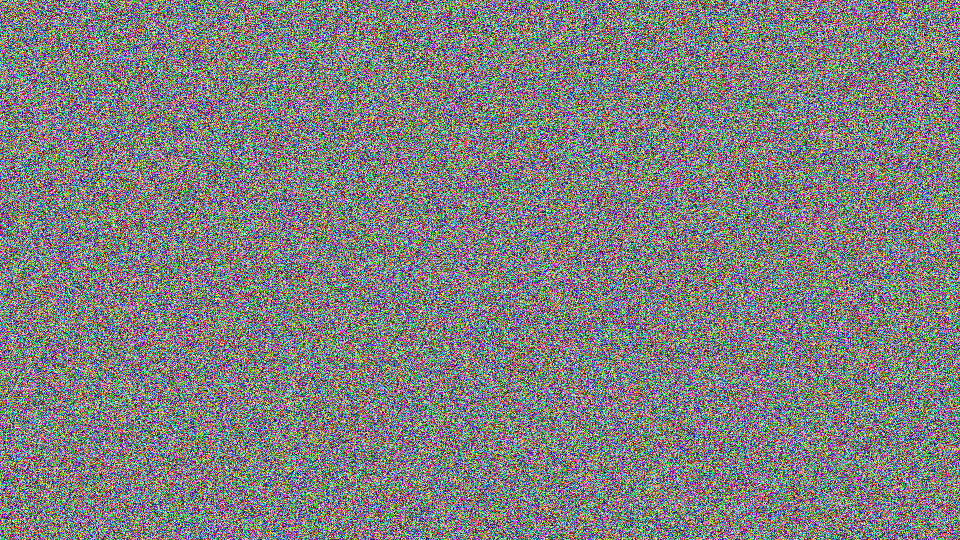

# BMP Image Generator

用 Rust 从零生成 BMP 位图的小项目。它不借助任何图像处理库，而是手动拼装 BMP 的文件头、信息头和像素数据，适合用来练习二进制文件格式与 Rust 的文件写入。

> 当前版本 v0.1：先实现“随机像素 + 正确的 BMP 结构”，后续会重构代码并生成有规律的图像。

## 效果

运行后生成一张 1920×1080 的随机噪点图（下图为缩放预览）：



## 功能

- 手写 14 字节 BMP 文件头与 40 字节信息头，字段全部按小端序写入
- 支持 24 位真彩色（每个像素按 B、G、R 三字节存储）
- 使用 `BufWriter` 缓冲写入，减少系统调用
- 纯标准库实现，唯一第三方依赖是 `fastrand`（随机数）

## 快速开始

### 环境要求

- Rust 1.85 或更高版本（`Cargo.toml` 使用 `edition = "2024"`）
- 检查版本：`rustc --version`

### 运行

```bash
cargo run --release
```

程序会在当前目录生成 `image.bmp`（约 6 MB），用系统自带的图片查看器即可打开。

### 构建

```bash
cargo build --release
```

生成的可执行文件位于 `target/release/`。

### 修改图片尺寸

打开 [src/main.rs](src/main.rs)，修改 `image_size`：

```rust
let image_size: [u32; 2] = [1920, 1080]; // [宽, 高]
```

> 建议宽度取 4 的倍数：BMP 要求每行字节数按 4 字节对齐，而当前实现还没有补行填充，详见“已知限制”。

## 项目结构

```text
.
├── Cargo.toml
├── src/
│   ├── main.rs                  # 程序入口：生成随机像素并写出 image.bmp
│   ├── lib.rs                   # 库入口，导出 image_file 模块
│   └── image_file/
│       ├── mod.rs               # 模块说明与 BMP 文件布局
│       ├── bitmap.rs            # BitMap：四部分元数据的组合
│       ├── file_info.rs         # 文件头、信息头、调色板
│       ├── pixels_data.rs       # 像素与像素数据容器
│       └── create_image.rs      # 创建、填充、序列化的公开函数
└── docs/
    └── demo.png                 # README 预览图
```

## BMP 文件格式笔记

一个未压缩的 24 位 BMP 文件可以分成 4 段：

| 组成 | 大小 | 说明 |
| --- | --- | --- |
| 文件头 | 14 B | `BM` 标识、文件总大小、像素数据偏移量 |
| 信息头 | 40 B | 宽度、高度、位深、压缩方式等 |
| 调色板 | 0 B | 24 位真彩色不需要调色板 |
| 像素数据 | 宽 × 高 × 3 B | 每个像素按 B、G、R 顺序存储 |

几个容易踩的细节：

- **小端序**：BMP 的多字节整数都按小端序（little-endian）存储，因此代码里统一使用 `to_le_bytes()`。
- **BGR 而不是 RGB**：`Pixel` 的字段顺序是蓝、绿、红，写文件时不能写反。
- **行填充**：BMP 规定每一行像素的字节数必须是 4 的倍数，不足时用 0 补齐。1920 × 3 = 5760，刚好是 4 的倍数，所以当前示例不受影响。
- **行序**：高度为正数时，像素行按自下而上的顺序存储；因为生成的是随机噪点，看起来没有区别。

对应代码：文件头见 [file_info.rs](src/image_file/file_info.rs) 中的 `BitMapFileHeader`，信息头见 `BitMapInfoHeader`，像素序列化见 [pixels_data.rs](src/image_file/pixels_data.rs) 中的 `Pixel::translator`。

## 代码导读

1. `create_image::new(size, 24)`：创建空的 `BitMap`，自动计算文件大小和像素数据偏移量。
2. `create_image::new_pixel([b, g, r])`：构造一个像素。
3. `create_image::write(&mut image.raw_pixel_data, pixels)`：把像素数据放进图像。
4. `create_image::translator(image, &mut data_stream)`：按 BMP 顺序序列化所有字节。
5. 用 `BufWriter` 把字节流写入 `image.bmp`。

更详细的说明可以直接阅读源码中的文档注释，或运行：

```bash
cargo doc --open
```

## 已知限制

- **只完整支持 24 位**：`create_image::new` 接受 24 或 32，但像素数据始终写 3 字节，32 位模式下生成的文件不正确；入口程序固定使用 24。
- **没有行填充**：当 `宽度 × 3` 不是 4 的倍数时，生成的文件可能无法被正确读取（默认的 1920 宽度不受影响）。
- **参数固定**：输出文件名、尺寸和像素内容都写在代码里，尚未接入命令行参数。
- **只有随机图像**：暂时没有渐变、几何图形等规律内容。

## 后续计划

- [ ] 重构代码组织形式，让各层职责更清晰
- [ ] 支持生成有规律的图像（渐变、几何图形等）
- [ ] 补齐 8/32 位支持与行填充
- [ ] 通过命令行参数指定尺寸、文件名和图案

## 依赖

| 依赖 | 版本 | 用途 |
| --- | --- | --- |
| fastrand | 1.9 | 生成随机像素 |

## 许可证

本项目采用 [GNU General Public License v3.0](LICENSE)（GPL-3.0）授权，完整条款见仓库根目录的 [LICENSE](LICENSE) 文件。
